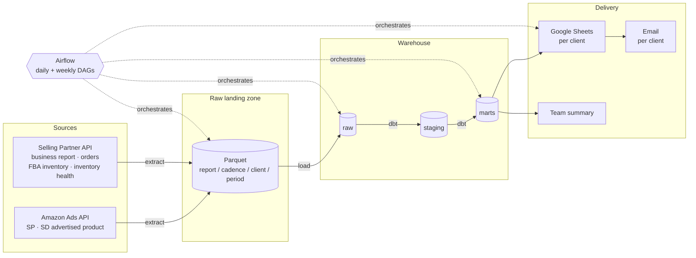
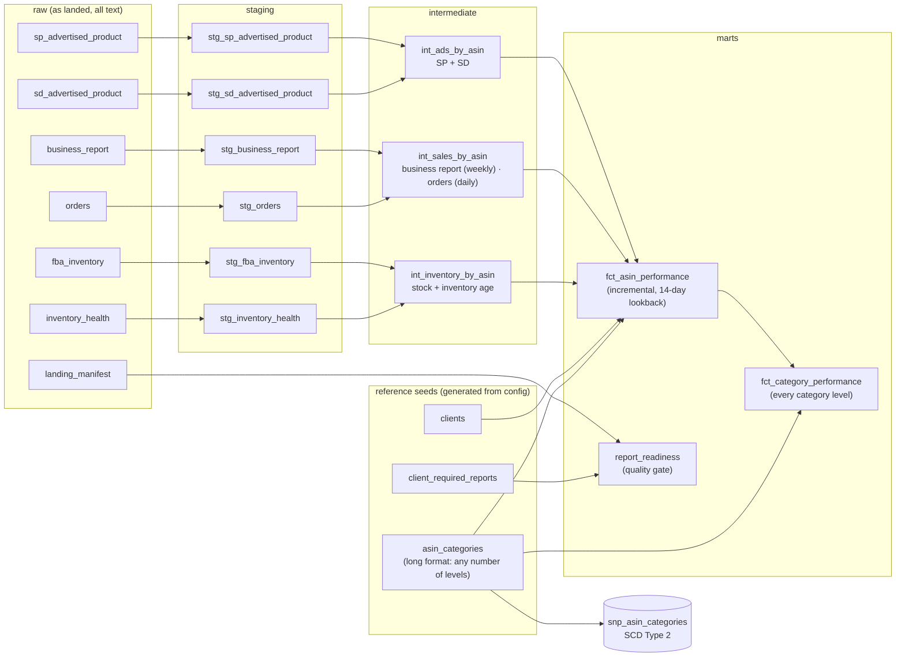

# Amazon Ads ELT Platform: Daily & Weekly Client Reporting

**A modern data-engineering rebuild of a production Amazon Ads reporting pipeline**: Snowflake / DuckDB, dbt, Airflow and Docker, delivering daily and weekly performance reports to clients through Google Sheets and email.

> **Status: ✅ Implemented.** Extraction, warehouse load, dbt models and tests, quality-gated delivery and Airflow orchestration are built (~2,100 lines of Python and SQL). The source code is kept private; this repository documents the design. A code walkthrough is available on request.

---

## Why this project

The original pipeline served **100+ Amazon seller accounts across 8 marketplaces** with plain Python scripts:

| Original scripts | Problem |
|---|---|
| Each script run by hand or cron, one after another | No dependency tracking: if step 2 fails, step 3 still runs on stale files |
| 600-line pandas script merges 5 reports into Excel | Business logic hidden in code, hard to test or change |
| CSV / Excel files on Google Drive as the "database" | No history, no schema, no way to query across clients |
| Reports sent whatever the data looks like | No quality checks: a missing report becomes a row of zeros in a client's inbox |
| Daily and weekly logic copied in separate scripts | The two drift apart over time |

**Scope:** this project rebuilds the **Client Performance Reports** (daily and weekly, product level). Their sources:

| Report | Weekly | Daily |
|---|:---:|:---:|
| Sponsored Products + Sponsored Display **advertised product** (product reports) | ✅ | ✅ |
| **Business report** (sessions, revenue, units) | ✅ | |
| **Orders** report (revenue, units) | | ✅ |
| **FBA inventory** + **inventory health** (inventory reports) | ✅ | ✅ |

The separate MIS management report (campaign level: SP/SB/SD campaign reports plus orders) is out of scope here.

This rebuild turns it into a proper **ELT platform**: raw data lands untouched, a warehouse holds the history, dbt owns the business logic as tested SQL, and Airflow runs everything on schedule with a quality gate before anything reaches a client.

---

## Architecture



---

## Tech stack

| Layer | Tool | Why |
|---|---|---|
| **Extract** | Python (requests, pandas) | Amazon async reports: request → poll → download → normalise |
| **Raw storage** | Parquet on local disk / S3 | Cheap, columnar, partitioned by report, client and date |
| **Warehouse** | **DuckDB** (default, free) · **Snowflake** (switchable target) | Same dbt project runs on both: DuckDB locally at no cost, Snowflake as the cloud warehouse |
| **Transform** | **dbt** | Business logic as version-controlled SQL with tests, docs and lineage |
| **Orchestration** | **Apache Airflow** | Scheduled DAGs, retries, per-client task mapping, alerting, run history |
| **Delivery** | Google Sheets API, SMTP / Gmail | Clients keep receiving reports where they already look |
| **Packaging** | **Docker Compose** | One command starts Airflow + the whole pipeline |
| **Quality** | dbt tests, source freshness | Bad data blocks delivery instead of reaching clients |

---

## Data model



| Model | Grain | What it holds |
|---|---|---|
| `fct_asin_performance` | client · cadence · period · ASIN | impressions, clicks, ad spend (SP / SD split), ad sales, ad units, revenue, total units, sessions, stock, reserved, inventory 90+ / 180+, ACOS, TACOS, CTR, CPC, conversion rate, ISO week |
| `fct_category_performance` | client · cadence · period · category level · category | the same metrics rolled up, ratios recalculated from totals |
| `report_readiness` | client · cadence · period | required vs landed reports, `is_ready`, list of missing reports |
| `snp_asin_categories` | client · ASIN · category level, over time | category mapping history (valid from / to) |

**Metrics are defined once, as dbt macros:** ACOS, TACOS, CTR, CPC and conversion rate, all with safe division that returns *null* (not 0) when there is nothing to divide by. Daily, weekly, ASIN and category numbers always use the same definitions.

### Engineering details

- **Incremental model with a 14-day lookback.** Amazon keeps attributing sales to ad clicks for up to 14 days. Daily runs re-pull and reprocess the last 14 days with a delete-and-insert merge, so recent numbers settle without rebuilding history.
- **Snapshots (SCD Type 2).** Category mapping changes are kept as history, so past reports can be reproduced exactly.
- **Idempotent everything.** Raw files are written one per report, client, cadence and period; warehouse tables are keyed the same way. Re-running a day or week replaces it.
- **Per-client rules as data, not code.** Which reports each account needs (some have no Sponsored Display, some no FBA) lives in a config file, generated into a seed.
- **Schema drift handled at landing.** Amazon has shipped two inventory-age layouts; both are normalised before loading.
- **One codebase, two warehouses.** The same dbt project targets DuckDB (free, local) or Snowflake, with cross-database macros where SQL differs.

### Data tests

| Test | Catches |
|---|---|
| One row per client · cadence · period · ASIN | duplicate loads |
| Category totals equal ASIN totals, for every category level | ASINs dropped or double counted in roll-ups |
| Spend and revenue never negative | bad casts or broken source data |
| Accepted values for cadence, sales source and report names | config typos |
| Every fact row's client exists in the client list | orphan data |
| Source freshness on every raw table | a fetcher that silently stopped |
| Weekly ad sales not far above total sales (warning) | a missing or partial business report |

---

## Reports delivered

| | **Daily report** | **Weekly report** |
|---|---|---|
| **Schedule** | Every day, 06:00 UTC | Every Monday, 06:00 UTC |
| **Period** | Yesterday, plus a 14-day re-pull so late-attributed sales settle | Last full Monday–Sunday week |
| **Sales source** | Orders report | Business report (with sessions) |
| **Workbook** | `<client>_daily_report.xlsx` | `<client>_weekly_report.xlsx` |
| **Sheets** | `ASIN` (full history) · `Latest` (this period, by ad spend) · `Category` (every category level, TOTAL row first) | same |
| **Email** | Ad spend, ad sales and revenue vs the previous period, ACOS, TACOS, top 5 products by ad spend, workbook attached | same, week over week |
| **Google Sheets** | Optional mirror of `Latest` and `Category` per client | same |
| **Re-run** | Replaces that day | Replaces that week |

---

## Airflow DAGs

```
ads_daily_report  (0 6 * * *)   ·   ads_weekly_report  (0 6 * * 1)

build_reference ─▶ extract ─▶ load_raw ─▶ dbt_seed ─▶ dbt_snapshot ─▶ dbt_build (models + tests)
                                                                          │
                                                       clients_to_deliver ─▶ deliver_client [mapped: one per client]
                                                                          │
                                                                    team_summary
```

- **dbt is the quality gate.** If any model or test fails in `dbt_build`, nothing downstream runs and no client receives a report.
- **Per-client readiness.** Even when the build passes, a client whose required reports did not all arrive is flagged in the team summary instead of being sent zeros.
- **Dynamic task mapping.** One delivery task per client: a failing client is retried on its own and never blocks the others.
- **Retry rounds in extract.** Flaky Amazon reports are retried in rounds; configuration errors (unsupported marketplace) are not retried.
- **Retries and failure alerts** on every task; full run history in the Airflow UI.

---

## Repository layout (private source)

```
├── ingestion/          # Ads API + SP-API fetchers, raw landing, seed builder
├── loaders/            # raw Parquet → warehouse raw schema (DuckDB rebuild / Snowflake upsert)
├── dbt/                # staging, intermediate, marts, macros, seeds, snapshot, tests
├── reporting/          # quality-gated delivery: Excel workbook, Google Sheets, email
├── airflow/dags/       # ads_daily_report, ads_weekly_report (one mapped task per client)
├── config/             # clients.yml control plane (+ git-ignored secrets)
├── run.py              # whole pipeline in order, without Airflow
└── docker-compose.yml  # Airflow + Postgres
```

---

## Related work

- [amazon-ads-reporting-pipelines](https://github.com/Jyoti-op/amazon-ads-reporting-pipelines): the original production pipelines this project rebuilds.
- [amazon-ads-ai-agent-platform](https://github.com/Jyoti-op/amazon-ads-ai-agent-platform): AI agent platform (MCP, 67 tools) on top of an S3 data lake.

---

## Author

Jyoti G, data engineer. Built and ran the original production pipelines for 100+ Amazon seller accounts; this project rebuilds them on a modern data stack.
