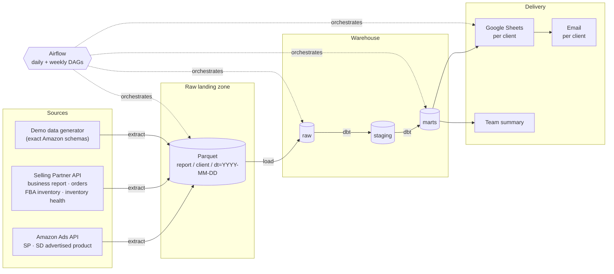
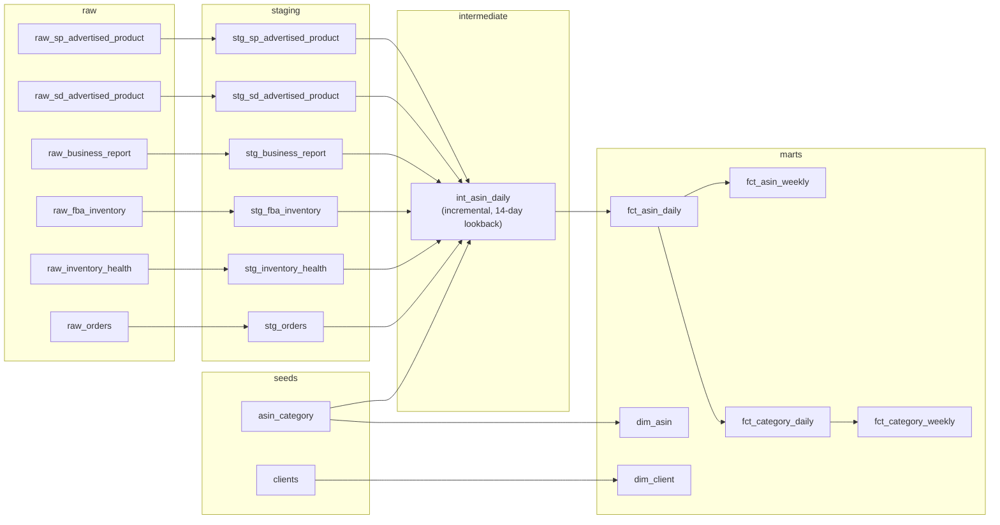

# Amazon Ads ELT Platform: Daily & Weekly Client Reporting

**A modern data-engineering rebuild of a production Amazon Ads reporting pipeline**: Snowflake / DuckDB, dbt, Airflow, Docker and GitHub Actions, delivering daily and weekly performance reports to clients through Google Sheets and email.

> **Status: 🚧 planned, build in progress.** This README is the project plan and design. Sections are ticked off in the [roadmap](#roadmap) as each phase lands.

---

## Why this project

The original pipeline served **100+ Amazon seller accounts across 8 marketplaces** with plain Python scripts:

| Today (scripts) | Problem |
|---|---|
| Each script run by hand or cron, one after another | No dependency tracking: if step 2 fails, step 3 still runs on stale files |
| 600-line pandas script merges 5 reports into Excel | Business logic hidden in code, hard to test or change |
| CSV / Excel files on Google Drive as the "database" | No history, no schema, no way to query across clients |
| Reports sent whatever the data looks like | No quality checks: a missing report becomes a row of zeros in a client's inbox |
| Daily and weekly logic copied in separate scripts | The two drift apart over time |

**Scope:** this project rebuilds the **Client Performance Reports** (daily and weekly, product level). Their sources:

| Report | Weekly | Daily |
|---|:---:|:---:|
| Sponsored Products + Sponsored Display **advertised product** (product reports) | ✅ | ✅ |
| **Business report** (sessions, revenue, units) | ✅ | |
| **Orders** report (revenue, units) | | ✅ |
| **FBA inventory** + **inventory health** (inventory reports) | ✅ | ✅ |

The separate MIS management report (campaign level: SP/SB/SD campaign reports plus orders) is out of scope here.

This rebuild turns it into a proper **ELT platform**: raw data lands untouched, a warehouse holds the history, dbt owns the business logic as tested SQL, and Airflow runs everything on schedule with a quality gate before anything reaches a client.

---

## Target architecture



---

## Tech stack

| Layer | Tool | Why |
|---|---|---|
| **Extract** | Python (requests, pandas) | Amazon async reports: request → poll → download → normalise |
| **Raw storage** | Parquet on local disk / S3 | Cheap, columnar, partitioned by report, client and date |
| **Warehouse** | **DuckDB** (default, free) · **Snowflake** (switchable target) | Same dbt project runs on both; DuckDB for dev and CI at $0, Snowflake for production-style demo |
| **Transform** | **dbt** | Business logic as version-controlled SQL with tests, docs and lineage |
| **Orchestration** | **Apache Airflow** | Scheduled DAGs, retries, per-client task mapping, alerting, run history |
| **Delivery** | Google Sheets API, SMTP / Gmail | Clients keep receiving reports where they already look |
| **Packaging** | **Docker Compose** | One command starts Airflow + the whole pipeline |
| **CI/CD** | **GitHub Actions** | Lint, unit tests and a full `dbt build` on every push |
| **Quality** | dbt tests, source freshness | Bad data blocks delivery instead of reaching clients |

---

## Data model



| Model | Grain | Key metrics |
|---|---|---|
| `fct_asin_daily` | client · marketplace · ASIN · day | impressions, clicks, ad spend, ad sales, ad units, sessions, revenue, total units, orders, stock |
| `fct_asin_weekly` | client · marketplace · ASIN · ISO week | the same, summed by week |
| `fct_category_daily` / `weekly` | client · category · day / week | category roll-ups |
| `dim_asin` | ASIN | category, price, inventory age (snapshot history) |
| `dim_client` | client · marketplace | report settings, recipients, active flag |

**Metrics are defined once, as dbt macros:** ACOS, TACOS, CTR, CPC, conversion rate, all with safe division. Daily and weekly reports use the same definitions, so they can never disagree.

### Engineering details planned

- **Incremental loads with a 14-day lookback.** Amazon keeps attributing sales to ad clicks for up to 14 days. Each run reprocesses only the last 14 days and merges them in, so recent numbers settle without rebuilding history.
- **Snapshots (SCD Type 2).** Category and price changes per ASIN are kept as history, so old reports can be reproduced exactly.
- **Idempotent everything.** Re-running a day or week replaces it; nothing is ever duplicated.
- **Per-client account rules as data, not code.** Which reports each account needs (some have no FBA, some have no SD) lives in a seed table instead of `if/elif` branches.

---

## Reports delivered

| | **Daily report** | **Weekly report** |
|---|---|---|
| **Schedule** | Every day, 06:00 UTC | Every Monday, 06:00 UTC |
| **Period** | Yesterday (with 14-day correction of recent days) | Last full ISO week |
| **Google Sheet tabs** | `Daily ASIN`, `Daily Category` (rolling history) | `Weekly ASIN`, `Weekly Category` (one block per week) |
| **Email** | Short summary: spend, sales, ACOS, TACOS vs previous day, top movers | Week-over-week summary, top and bottom ASINs, category table, sheet link |
| **Same week / day re-run** | Replaces that day | Replaces that week |
| **Recipients** | From `clients` seed, per client | Same |

---

## Airflow DAGs

```
ads_daily_pipeline   (0 6 * * *)          ads_weekly_pipeline   (0 6 * * MON)
──────────────────────────────            ───────────────────────────────
extract_reports  [per report type]        wait_for_daily_success
      │                                         │
load_raw                                  dbt_build  --select +fct_*_weekly
      │                                         │
dbt_source_freshness                      dbt_test   (quality gate)
      │                                         │
dbt_build  --select +fct_*_daily          write_google_sheets  [per client]
      │                                         │
dbt_test   (quality gate)                 send_client_email    [per client]
      │                                         │
write_google_sheets  [per client]         notify_team
      │
send_client_email    [per client]
      │
notify_team
```

- **Quality gate.** If any dbt test fails (duplicate rows, missing day, negative spend, ACOS out of range, stale source), client delivery is skipped and the team is alerted.
- **Dynamic task mapping.** One sheet task and one email task per client, so one failing client never blocks the rest and only the failure is retried.
- **Retries and alerts** on every task; full run history in the Airflow UI.

---

## Demo mode: no real client data

This repository is public, so it never touches real accounts:

- A **data generator** produces realistic Amazon Ads and SP-API reports in the exact production column formats, for fictional brands ("Demo Brand US", "Demo Brand UK"...), including late-arriving attribution so the 14-day logic has something to correct.
- **Demo delivery** writes to the author's own test Google Sheets and emails the author, so screenshots show the real thing working.
- **Live mode** (real Amazon APIs, real recipients) is the same code with a config switch, and is never enabled in this repository.

No credentials are ever committed; everything is read from a local `.env`.

---

## Planned repository layout

```
├── ingestion/          # extract: Amazon API clients + demo data generator
├── loaders/            # raw Parquet → warehouse (DuckDB / Snowflake)
├── dbt/                # models, macros, seeds, snapshots, tests
├── reporting/          # Google Sheets writer, email builder
├── airflow/
│   └── dags/           # ads_daily_pipeline, ads_weekly_pipeline
├── tests/              # pytest: generator, metrics, report builder
├── docker-compose.yml  # Airflow + Postgres metadata DB
└── .github/workflows/  # CI: lint, tests, dbt build on DuckDB
```

---

## Roadmap

- [ ] **Phase 1: Ingestion.** Demo data generator in exact Amazon schemas for all six reports (SP and SD advertised product, business report, orders, FBA inventory, inventory health); extract step writing partitioned Parquet
- [ ] **Phase 2: Warehouse + dbt.** Raw load to DuckDB; staging, intermediate and mart models; metric macros; tests; snapshots; docs and lineage
- [ ] **Phase 3: Reporting.** Google Sheets writer and email builder for daily and weekly reports
- [ ] **Phase 4: Orchestration.** Airflow daily and weekly DAGs with quality gate and per-client mapping, running in Docker
- [ ] **Phase 5: Snowflake.** Switchable Snowflake target, roles and schemas, same dbt project
- [ ] **Phase 6: CI/CD.** GitHub Actions running lint, pytest and `dbt build` on every push
- [ ] **Phase 7: Showcase.** dbt docs site, lineage graph, Airflow and Snowflake screenshots, demo video

---

## Cost

| Component | Cost |
|---|---|
| DuckDB, dbt Core, Airflow, Docker, GitHub Actions | Free |
| Google Sheets / Drive API, Gmail SMTP | Free within normal limits |
| Snowflake | Free 30-day trial, then pay-per-use (optional; DuckDB covers everything else) |

---

## Related work

- [amazon-ads-reporting-pipelines](https://github.com/Jyoti-op/amazon-ads-reporting-pipelines): the original production pipelines this project rebuilds.
- [amazon-ads-ai-agent-platform](https://github.com/Jyoti-op/amazon-ads-ai-agent-platform): AI agent platform (MCP, 67 tools) on top of an S3 data lake.

---

## Author

Jyoti G, data engineer. Built and ran the original production pipelines for 100+ Amazon seller accounts; this project rebuilds them on a modern data stack.
